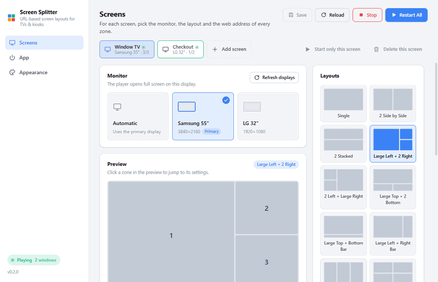
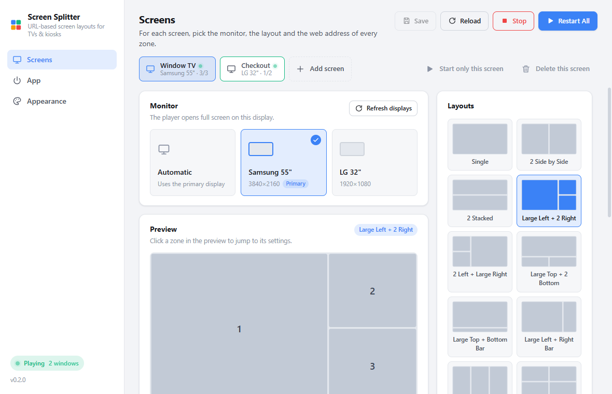
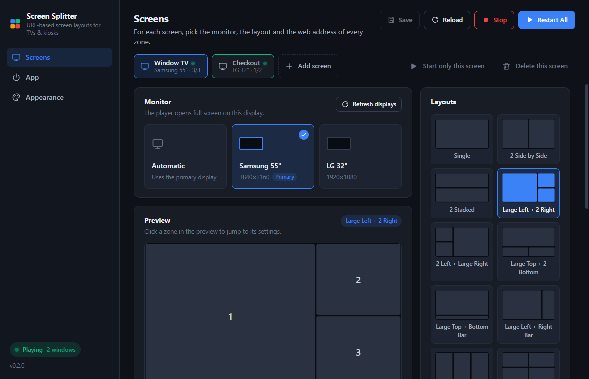

# Screen Splitter

[](https://github.com/mfakyol/screen-splitter/releases/latest)
[](https://github.com/mfakyol/screen-splitter/releases/latest)
[](LICENSE)

Digital signage for store TVs and kiosks. Screen Splitter divides a display into zones, loads a web page into each zone and runs them full screen on the monitors you choose. It starts with Windows and keeps running in the tray.

**[⬇ Download for Windows](https://github.com/mfakyol/screen-splitter/releases/latest)**



| Light theme | Dark theme |
|---|---|
|  |  |

## Features

- **12 layouts:** single, side by side, stacked, large + small combinations, 3 columns and 2x2 / 3x2 / 3x3 grids
- **Multiple monitors:** every monitor gets its own layout and zones. Start them all at once or one at a time
- **Any website:** each zone is an isolated browser view, so pages that refuse to be embedded still load
- **Per-zone control:** auto-refresh interval, zoom level and mute
- **Kiosk mode:** frameless, always on top, hidden from the taskbar, mouse cursor hidden
- **Self-healing:** failed pages retry automatically, crashed pages reload, windows follow monitors that are plugged in or removed
- **Starts with Windows:** can open straight into the player without showing the settings window
- **Backup:** export all settings to a file and import them on another device
- **Light and dark themes** with six accent colors
- **English, Turkish and German** interface

## Tech stack

| Area | Technology |
|---|---|
| Desktop runtime | Electron 44: kiosk windows per monitor, one `WebContentsView` per zone, tray and global shortcuts |
| Interface | React 19, TypeScript 7 |
| Build | Vite 7 through electron-vite |
| Packaging | electron-builder (NSIS installer) |
| Testing | Vitest, Testing Library, jsdom (150 tests) |

## Getting started

1. Download and run the installer. It is unsigned, so on first run choose **More info → Run anyway** in the SmartScreen prompt.
2. On the **Screens** page pick a monitor and a layout, then enter a web address for each zone.
3. Use **Add screen** to set up another monitor.
4. Press **Start All**. To get back to the settings, press `Ctrl+Shift+S` or double-click the tray icon.
5. On the **App** page turn on **Launch at Windows login** so the screens come back after a restart.

## Keyboard shortcuts

| Shortcut | Action |
|---|---|
| `Ctrl+Shift+S` | Open the settings window |
| `Ctrl+Shift+X` | Stop the player |
| `Ctrl+Shift+R` | Reload all zones |
| `Ctrl+Shift+Q` | Quit |

## Backing up settings

**Export settings** on the App page saves everything (screens, layouts, addresses, preferences) to a single JSON file; **Import settings** loads it on any machine. Settings live in `%APPDATA%\Screen Splitter\config.json`. A file exported from a newer version of the app is rejected with a prompt to update, so older installs never misread it.

## Requirements

Windows 10 or later, 64-bit.

## Building from source

```bash
npm install
npm run dev     # run with hot reload
npm test        # 150 unit and component tests
npm run dist    # build the Windows installer into dist/
```

## License

[MIT](LICENSE)
